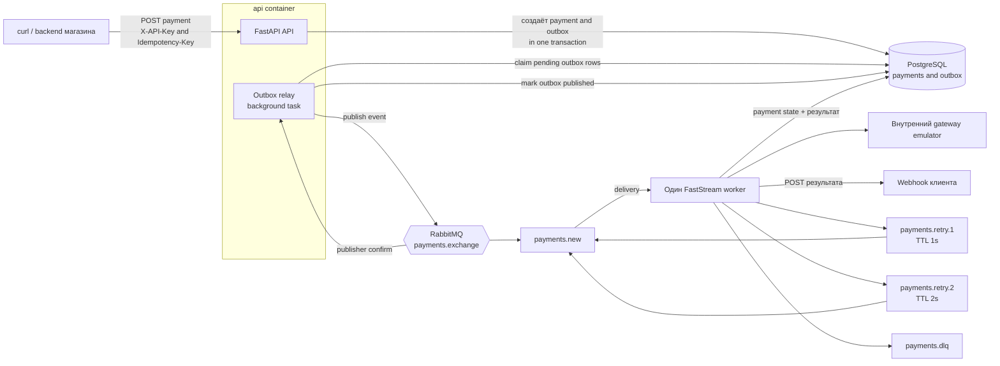
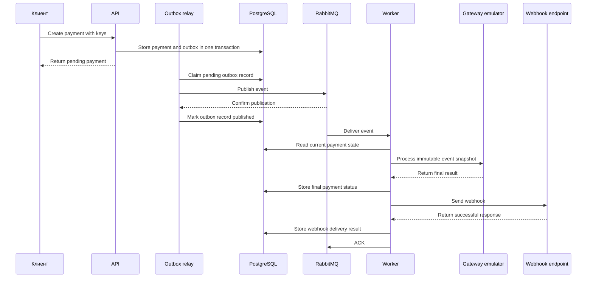
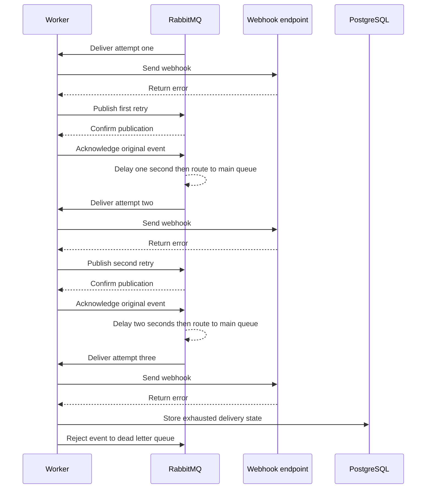

# Архитектура

## Компоненты

Relay — отдельный **логический компонент**, но не отдельный Compose-сервис: при
старте `api`-контейнера FastAPI lifespan запускает один фоновый asyncio-цикл.
HTTP-обработчик только записывает `payment` и `outbox` в транзакции и никогда не
публикует сообщение в RabbitMQ сам. Relay периодически захватывает pending
строки из PostgreSQL, публикует их и отмечает `published` только после broker
confirm. Его можно вынести в самостоятельный процесс без изменения контракта с
БД или RabbitMQ; для объёма тестового пока оставляем его внутри `api`-контейнера.

`webhook-sink` подключается как demo-сервис в Docker Compose. Он не участвует
в обработке платежа: принимает callback и позволяет увидеть результат в логах
или через диагностический endpoint.

## Правило реализации портов

Порты application-слоя определяются через `Protocol`. Каждый конкретный adapter,
включая test double, **явно наследуется** от реализуемого порта и помечает его
методы `@override`. Это даёт IDE и статическому анализатору возможность
проверить имя и сигнатуру метода рядом с его объявлением, а не только в точке,
где adapter передаётся в use case. Импорт порта в infrastructure — допустимая
зависимость наружного слоя от внутреннего; скрывать базовый класс под
`TYPE_CHECKING` нельзя, потому что он нужен Python при создании класса.

## Успешный путь

## Ошибка webhook

## Очереди и ответственность

| Очередь | Назначение | Кто пишет | Кто читает |
| --- | --- | --- | --- |
| `payments.new` | Основная обработка payment event | Relay и retry-очереди через DLX | Worker |
| `payments.retry.1` | Первая задержка, 1 секунда | Worker | RabbitMQ TTL/DLX |
| `payments.retry.2` | Вторая задержка, 2 секунды | Worker | RabbitMQ TTL/DLX |
| `payments.dlq` | Сообщения после третьей неудачи | RabbitMQ | Человек через Management UI |

Все рабочие очереди и сообщения durable/persistent. Worker использует manual ACK,
чтобы RabbitMQ мог redeliver не подтверждённое при падении consumer сообщение.
Publisher confirms подтверждают только приём сообщения брокером, а не завершение
работы worker.
