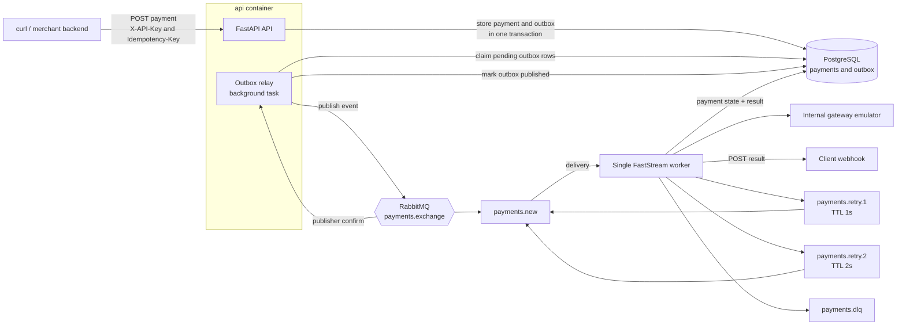
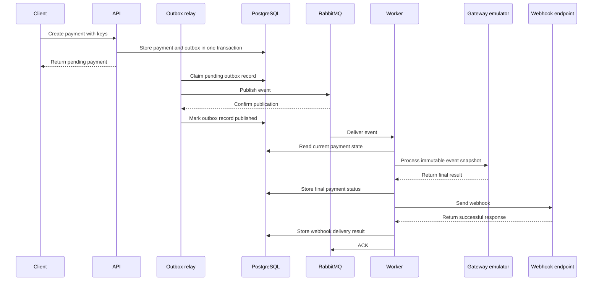
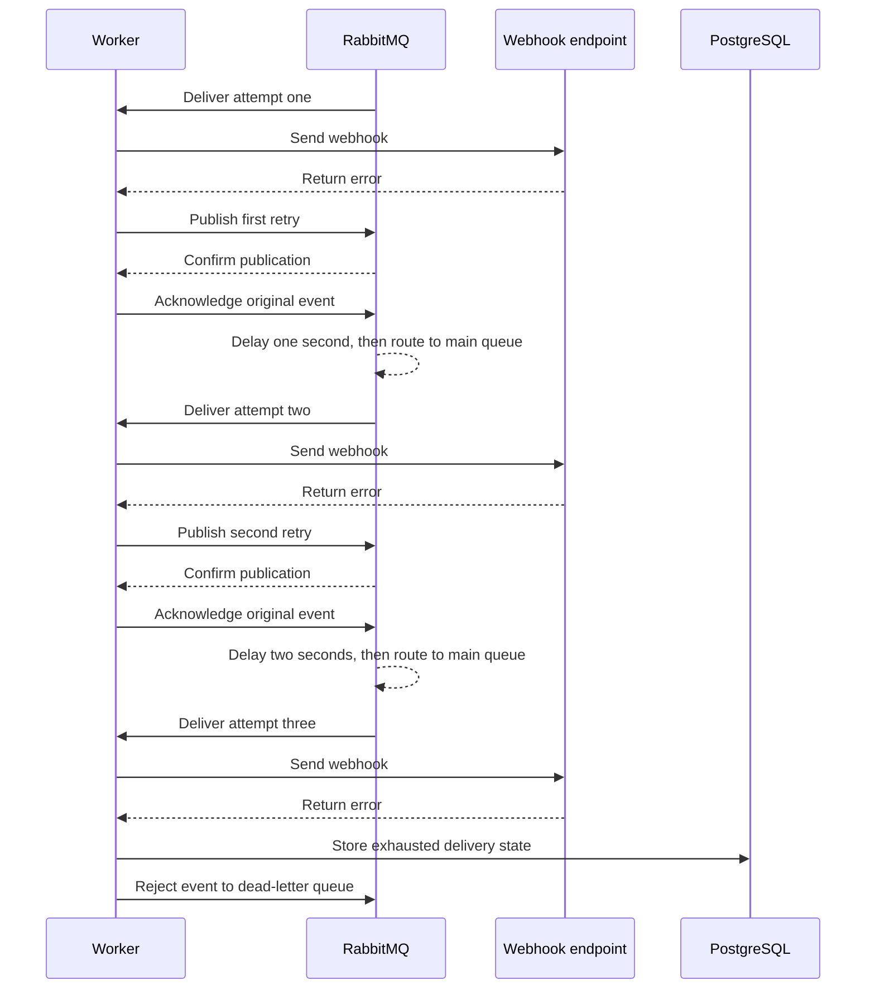

# Architecture

## Components

The relay is a separate **logical component**, but not a separate Compose
service. When the `api` container starts, the FastAPI lifespan launches one
background asyncio loop. The HTTP handler only writes the payment and outbox row
in a transaction; it never publishes directly to RabbitMQ. The relay periodically
claims pending rows from PostgreSQL, publishes them, and marks them `published`
only after broker confirmation. It could be moved to its own process without
changing its database or RabbitMQ contracts; for this assignment, it remains in
the `api` container.

`webhook-sink` is included in Docker Compose as a demo service. It does not take
part in payment processing: it receives callbacks and lets us inspect the result
in logs or through a diagnostic endpoint.

## Port implementation rule

Application-layer ports are defined with `Protocol`. Every concrete adapter,
including test doubles, **explicitly inherits** from the port it implements and
marks its methods with `@override`. This lets the IDE and static type checker
verify method names and signatures where they are declared, rather than only
where the adapter is passed to a use case. Infrastructure may import a port
from the inner layer; hiding the base class under `TYPE_CHECKING` is not allowed,
because Python needs it when creating the class.

## Successful path

## Webhook failure

## Queues and responsibilities

| Queue | Purpose | Publisher | Consumer |
| --- | --- | --- | --- |
| `payments.new` | Main payment-event processing | Relay and retry queues through DLX | Worker |
| `payments.retry.1` | First delay, one second | Worker | RabbitMQ TTL/DLX |
| `payments.retry.2` | Second delay, two seconds | Worker | RabbitMQ TTL/DLX |
| `payments.dlq` | Messages after the third failure | RabbitMQ | Operator through Management UI |

All work queues and messages are durable/persistent. The worker uses manual ACK
so RabbitMQ can redeliver a message that was not acknowledged before a consumer
failure. Publisher confirms indicate that the broker accepted a message, not
that the worker completed it.

When RabbitMQ is unavailable, the API continues accepting payments into
PostgreSQL and the relay retries its connection. A handled publish error returns
the row to `pending`; cancellation during publication leaves it `processing`
until the lease expires. After successful passes, the relay deletes only old
published rows in bounded batches.

A recorded webhook failure does not cause another POST for the same attempt on
redelivery, though the retry message itself may be published more than once. A
failure between the POST and recording its result can cause another POST.
Technical gateway errors do not have a durable counter; exactly-once processing
is not guaranteed.
