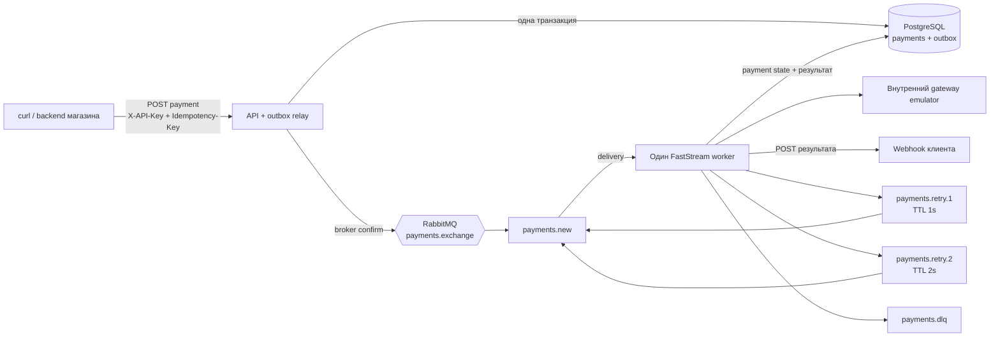
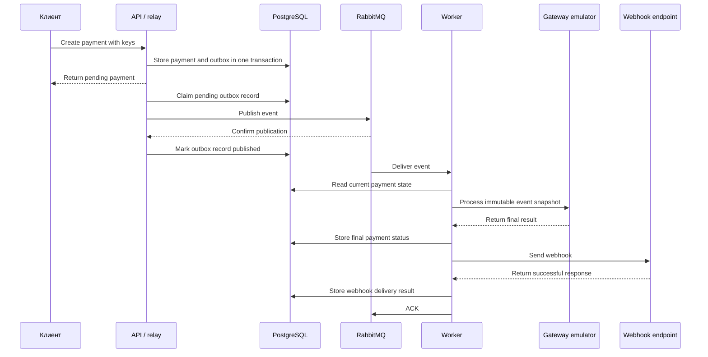
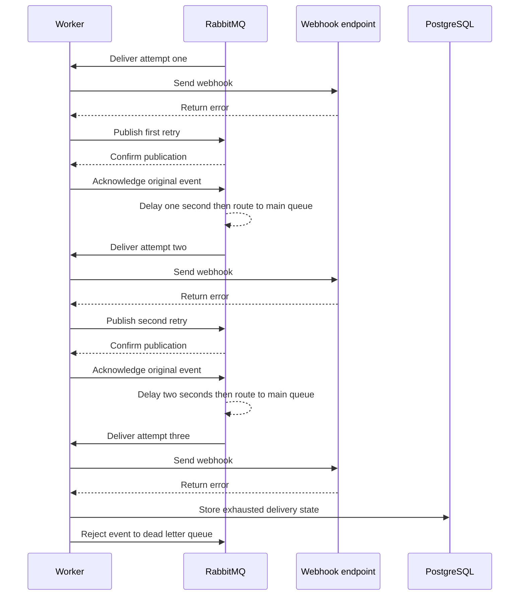

# Архитектура

## Компоненты

`webhook-sink` подключается как demo-сервис в Docker Compose. Он не участвует
в обработке платежа: принимает callback и позволяет увидеть результат в логах
или через диагностический endpoint.

## Успешный путь

## Ошибка webhook

## Очереди и ответственность

| Очередь | Назначение | Кто пишет | Кто читает |
| --- | --- | --- | --- |
| `payments.new` | Основная обработка payment event | Relay и retry-очереди через DLX | Worker |
| `payments.retry.1` | Первая задержка, 1 секунда | Worker | RabbitMQ TTL/DLX |
| `payments.retry.2` | Вторая задержка, 2 секунды | Worker | RabbitMQ TTL/DLX |
| `payments.dlq` | Сообщения после третьей неудачи | RabbitMQ | Человек через Management UI |

Все рабочие очереди и сообщения durable/persistent. Worker использует manual ACK,
чтобы RabbitMQ мог redeliver не подтверждённое при падении consumer сообщение.
Publisher confirms подтверждают только приём сообщения брокером, а не завершение
работы worker.
