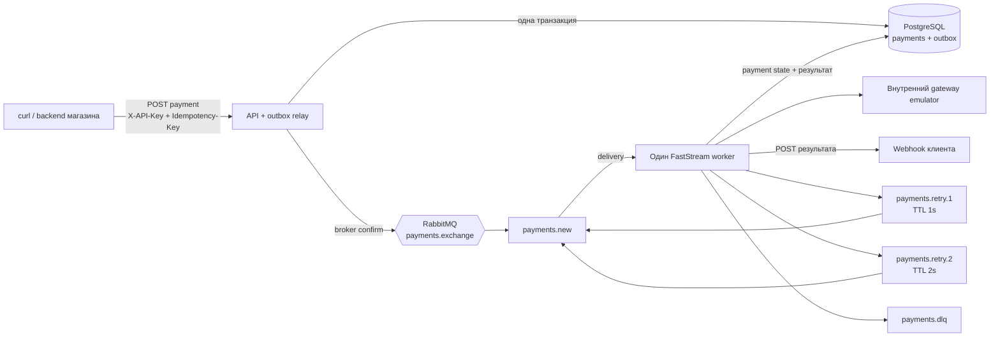

# Архитектура

## Компоненты



`webhook-sink` подключается как demo-сервис в Docker Compose. Он не участвует
в обработке платежа: принимает callback и позволяет увидеть результат в логах
или через диагностический endpoint.

## Успешный путь

```mermaid
sequenceDiagram
    participant C as Клиент
    participant A as API / relay
    participant P as PostgreSQL
    participant R as RabbitMQ
    participant W as Worker
    participant G as Gateway emulator
    participant H as Webhook endpoint

    C->>A: POST payment + ключи
    A->>P: BEGIN; payment + outbox; COMMIT
    A-->>C: 202 pending
    A->>P: claim pending outbox row
    A->>R: publish event
    R-->>A: publisher confirm
    A->>P: mark outbox published
    R->>W: delivery
    W->>P: read payment state
    W->>G: process immutable snapshot
    G-->>W: succeeded / failed
    W->>P: persist final payment status
    W->>H: POST webhook
    H-->>W: 2xx
    W->>P: persist webhook delivery
    W->>R: ACK
```

## Ошибка webhook

```mermaid
sequenceDiagram
    participant W as Worker
    participant R as RabbitMQ
    participant H as Webhook endpoint
    participant P as PostgreSQL

    R->>W: attempt 1
    W->>H: POST webhook
    H-->>W: timeout / non-2xx
    W->>R: publish retry.1
    R-->>W: publisher confirm
    W->>R: ACK original
    R-->>R: TTL 1s, route back to payments.new
    R->>W: attempt 2
    W->>H: POST webhook
    H-->>W: non-2xx
    W->>R: publish retry.2; confirm; ACK original
    R-->>R: TTL 2s, route back to payments.new
    R->>W: attempt 3
    W->>H: POST webhook
    H-->>W: non-2xx
    W->>P: persist exhaustion
    W->>R: reject to DLQ
```

## Очереди и ответственность

| Очередь | Назначение | Кто пишет | Кто читает |
| --- | --- | --- | --- |
| `payments.new` | Основная обработка payment event | Relay и retry-очереди через DLX | Worker |
| `payments.retry.1` | Первая задержка, 1 секунда | Worker | RabbitMQ TTL/DLX |
| `payments.retry.2` | Вторая задержка, 2 секунды | Worker | RabbitMQ TTL/DLX |
| `payments.dlq` | Сообщения после третьей неудачи | RabbitMQ | Человек через Management UI |

Все рабочие очереди и сообщения durable/persistent. Worker использует manual ACK,
чтобы RabbitMQ мог redeliver не подтверждённое при падении consumer сообщение.
Publisher confirms подтверждают только приём сообщения брокером, а не завершение
работы worker.
